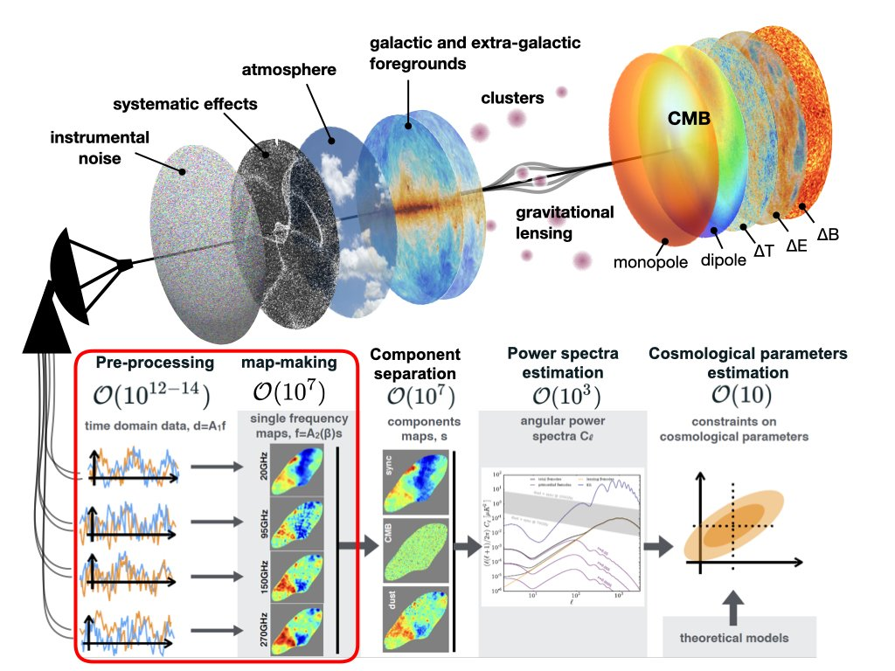
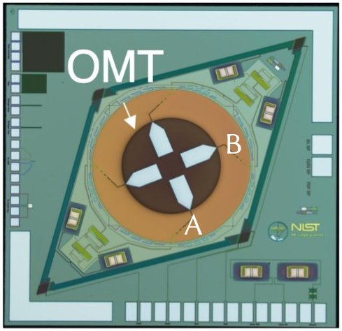
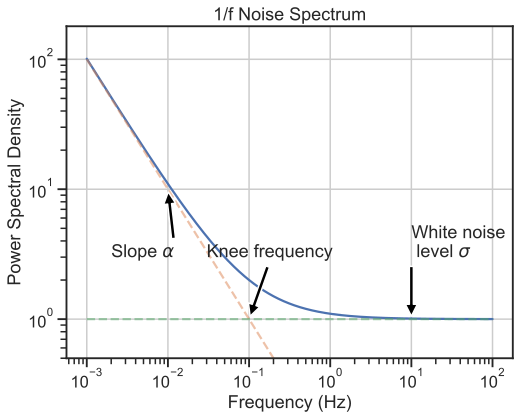
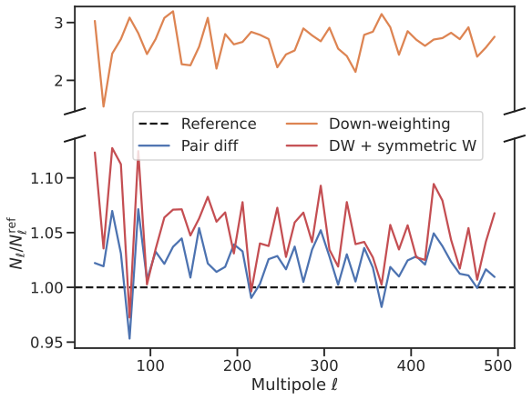
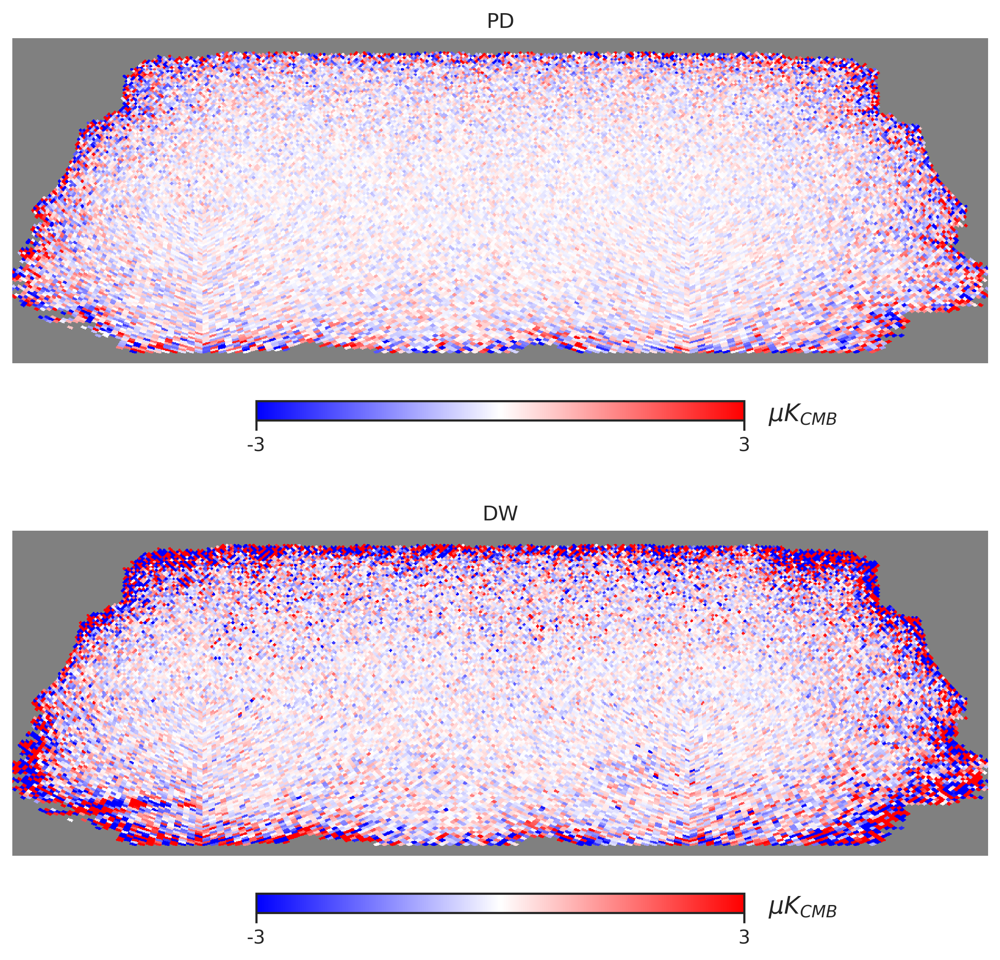
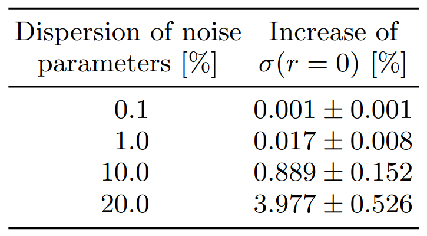
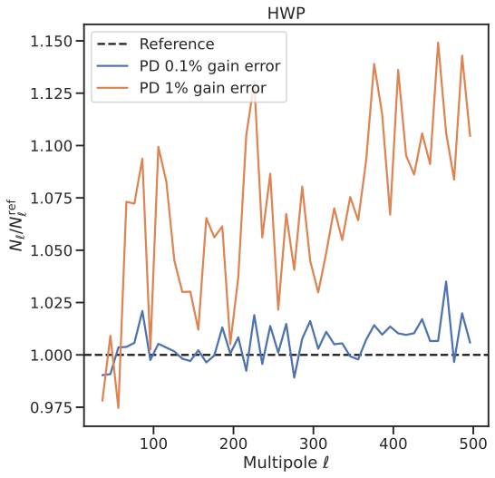
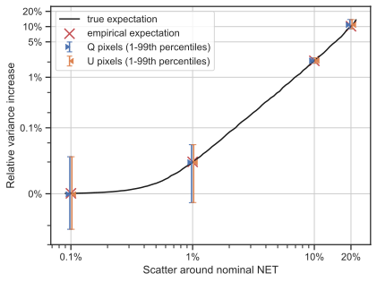

# CMB map-making in a nutshell {background-color="#40666e"}

## From time-ordered data to maps

::: {.notes}
Start from figure on the right!

Lensing converts $E$ → $B$ *and vice versa*.

CMB signal is faint: each individual data sample is noise dominated.

To achieve a good sensitivity across a significant sky area, CMB telescopes collect lost of measurements across the targeted area by **scanning**.
This also helps to mitigate low-frequency instrumental noise.

The raw data is therefore made of *time series* (one/detector) called time-ordered data (TOD).

With knowledge of the scanning strategy (pointing information) we can reconstruct the observed sky maps → **map-making**.

Map-making = key starting point of analysis pipeline

Must preserve all information + mitigate as many systematics as possible
:::

:::: {.columns3070}
::: {.column}
**map-making** = from time-ordered data (TOD) to sky maps at observed frequencies

data reduction step: ~6 orders of magnitude
:::

::: {.column}

:::
::::

## Linear data model {.smaller}

::: {.notes}
Formally: linear data model

Inverse problem -- what we recover/know/assume

Linear estimator = mapping of data to maps
:::

$$
d = Ps + Tx + n
$$

- we *know* $d$ (the data)
- we *estimate* $s$ (sky maps) and *marginalise* over $x$ (spurious signals)
- we *model* $P$ (pointing) and $T$ (templates)
- we *assume* that $n$ (noise) has covariance $N$

. . .

$T$ examples:

- "baselines" (constant offsets) → destriping
- HWP or scan-synchronous signals

. . .

"Map-making" is a linear operation $\hat s = L d$ that maps measurements to estimated sky maps.

## Unbiased estimators

::: {.notes}
Weighted co-addition of the data with spurious signals filtered out.
:::

Generic linear unbiased estimator [[Poletti et al. 2017]](http://www.aanda.org/10.1051/0004-6361/201629467)
$$
\hat s = (P^\top F_T P)^{-1} P^\top F_T d
$$

with filtering and weighting operator
$$
F_T = W \left[\mathbb I - T (T^\top W T)^{-1} T^\top W \right]
$$

- filters out unwanted signals (columns of $T$)
- weights orthogonal modes by weight matrix $W$
- "single step destriper" with generalised templates

Minimum variance (optimal) if $W = N^{-1}$ (generalised least squares, GLS).

# Polarisation maps from the ground {background-color="#40666e"}

::: {.notes}
All these points are part of the motivation for this study about reconstruction polarisation from the ground.

Submitted to PRD for publication consideration.
:::

**SB**, Errard and Stompor, 2025 [[arXiv:2509.16302](https://arxiv.org/abs/2509.16302), submitted to PRD]

## Observing from the ground {.smaller}

::: {.notes}
Major challenge for map-making from the ground: atmospheric emission

Loading → more photons on average

Extra effect: fluctuations because atmosphere is a turbulent medium

HWP: change angle of polarisation with respect to orientation of the waveplate

Goal of study: assess efficiency of technical solutions to mitigate atmosphere
:::

:::: {.columns6040}
::: {.column}
- Major challenge: atmosphere
  - much brighter than CMB
  - loading: increase detector noise
  - turbulence: spatial + temporal variations
  - negligible linear polarisation
- Hardware solutions
  - dual-polarisation detectors
  - continuously rotating HWP

:::: {.columns}
::: {.column width="35%"}

:::

::: {.column width="60%"}
).](assets/hwp/hwp.jpg)
:::
::::
:::

::: {.column}
![Emission spectrum of the atmosphere for different levels of PWV [[Morris et al. 2022]](https://doi.org/10.1103/PhysRevD.105.042004).](assets/atmosphere/atmosphere-emission.svg){.lightbox height=270}

:::
::::

## Unbiased polarisation map-making {.smaller}

::: {.notes}
Total intensity $I$ hard to recover from the ground because of atmosphere.

Focus on polarisation instead; temperature large scales already very well measured from space (*Planck*).

Compare DW and PD and see how they manage to take advantage of hardware solutions.

very demanding benchmark!
:::

Focus on **unbiased reconstruction** of polarisation ($Q$ and $U$).

Data: $d = Ps + Tx + n$

- **Minimal model**
  - $T$ very general: no specific temporal or spatial structure
  - atmosphere identical for orthogonal detectors
- **Down-weighting** (DW)
  - no template, $Tx \rightarrow n^\mathrm{atm}$
  - GLS with $W = (N_\mathrm{atm} + N_\mathrm{instr})^{-1}$
  - stationary noise, independent between detectors
- **Ideal reconstruction**
  - atmosphere-free data: $d = P s + n$ (instr. noise only)
  - GLS with $W = N_\mathrm{instr}^{-1}$
  - benchmark tool

## Pair differencing

::: {.notes}
Write down minimal model for one pair of detectors.

Use template filtering to estimate $Q$ and $U$, marginalising over $x$.

Find pair differencing!
:::

:::: {.columns}
:::{.column width="80%"}
Minimal model: $T \rightarrow \mathbb I$
$$
d = \begin{bmatrix} d^A \\ d^B \end{bmatrix}
    = \begin{bmatrix} \mathbb I \\ \mathbb I \end{bmatrix} x
    + \begin{bmatrix} P_{QU} \\ -P_{QU} \end{bmatrix} s_{QU}
    + \begin{bmatrix} n^A \\ n^B \end{bmatrix}
$$

GLS template filtering estimator gives
$$
\hat s_{QU} = (P_{QU}^\top N_-^{-1} P_{QU})^{-1} P_{QU}^\top N_-^{-1} d_-
$$
with $d_- \equiv d^A - d^B$ and $N_-$ the covariance of $n^A - n^B$.
:::

::: {.column width="20%"}
{.nostretch}
:::
::::

Minimal model equivalent to **pair-differencing** (PD).

Used e.g. in QUaD [[arXiv:0805.1944]](https://arxiv.org/abs/0805.1944), BICEP/Keck [[arXiv:1403.4302]](https://arxiv.org/abs/1403.4302), POLARBEAR [[arXiv:1403.2369]](https://arxiv.org/abs/1403.2369), SPT-3G [[arXiv:2505.02827]](https://arxiv.org/abs/2505.02827).

## Questions {.center}

1. Compare pair differencing and down-weighting
2. Compare with ideal reconstruction
3. Impact of systematic effects

## Numerical simulations {.smaller}

::: {.notes}
To answer these questions, I performed advanced time-domain simulations of an SO-like small aperture telescope.

I used the `toast` simulation framework and adjusted it for the needs of the study.

I used the NERSC and Jean-Zay supercomputers.

In particular I implemented the interface between `toast` and our reconstruction library, `mappraiser` (see figure).

Massively parallel implementation of the unbiased map-making estimator presented earlier, which I developed further.
:::

:::: {.columns6040}
::: {.column}
- SAT with 350 pairs of detectors + HWP
- Atmosphere simulation using [TOAST 3](https://github.com/hpc4cmb/toast/tree/toast3) framework
- Instrumental $1/f$ noise
  - $S(f) = \mathrm{NET}^2 [1 + (f_\mathrm{knee}/f)^\alpha]$
  - variation around nominal values
- Map-making code: [MAPPRAISER](https://github.com/b3dcmb/midapack) library [[arXiv:2112.03370]](http://arxiv.org/abs/2112.03370)

{.lightbox height=300}
:::

::: {.column}
{.lightbox}
:::
::::

## Results: PD vs DW

::: {.notes}
In the absence of systematics, PD is nearly optimal.

No need/reason to try and improve beyond that, unless a better model of atmosphere is available.

How precise is PD compared to ideal reconstruction (perfect model)?
:::

:::: {.columns}
::: {.column}
**Implicit** differencing in DW ($W_A = W_B$) necessary to avoid atmosphere leakage.

{.lightbox .nostretch height="300px"}
:::
::: {.column}
{.lightbox}
:::
::::

## Results: impact on $r$ {.smaller}

::: {.notes}
How do these results translate in terms of $r$ sensitivity?

Remarkably little impact given the very general assumption behind PD.
:::

- 25 realisations of realistic instrumental $1/f$ noise
- detector-dependent parameters (knee, slope, white level)
- noise power spectrum $N_\ell^{BB}$ from reconstructed maps $\hat s^\mathrm{pd}_{QU}$

Fisher forecast
$$
\sigma(r=0)^{-2} \approx \frac{f_\text{sky}}{2} \times \sum_{\text{bins $b$}} \Delta_\ell (2\ell_b+1) \Bigg( \frac{C_{\ell_b}^{BB,\text{prim}} \rvert_{r=1}}{C_{\ell_b}^{BB,\text{lens}} + \langle N_{\ell_b}^{BB} \rangle} \Bigg)^2
$$

Compare $\sigma(r=0)$ from PD with ideal reconstruction:

{.absolute left=300 height=200}

## Results: gain errors

::: {.notes}
systematics → possible atmosphere leakage

gain error: one example of systematic, "case study"

justify 1% gain error (achieved by other experiments)

expect similar conclusion for other effects
:::

:::: {.columns}
::: {.column}
- random gain error in pairs
- additional noise comparable to case with uneven detector noise at low multipoles
- efficient mitigation by HWP

Case-by-case analysis required for each systematic and each method
:::

::: {.column}

:::
::::

## Conclusions

- We want ground experiments to measure/constrain $r$
- For this, we need a robust (and efficient) analysis pipeline
- **This work**
  - clarifies assumptions behind pair differencing and down-weighting
  - demonstrates near-optimal performance of pair differencing with realistic instrumental noise
  - shows why orthogonal detector pairs + HWP are a powerful combination
- **Next steps**
  - other systematics (pointing, beam, HWP... you name it)
  - `furax` implementation (cf. previous talks by Wuhyun & Pierre) and application to Simons Observatory SAT data

# Backup

## Practical considerations {.smaller}

- Size of the problem
  - $\mathcal O(1000)$ detectors + months of data + sampling @100 Hz → $n_t \sim 10^{11}$ samples (TB scale)
  - resolution + sky coverage + Stokes (I)QU → $n_p \sim 10^5 - 10^8$ sky pixels
  - correlations → process data in one go
  - **Numerical efficiency** and parallelism are key!

. . .

- Noise correlations $N$ (size $n_t \times n_t$)
  - split data in chunks (trade-off efficiency/quality)
  - assume noise is stationary in each chunk, $N(t,t')=N(\lvert t-t' \rvert)$
  - characterise in Fourier space (power spectral density, PSD)

. . .

- **Iterative solvers**
  - $\hat s = A^{-1} b$ → instead solve $A s = b$
  - store $A$ implicitly without constructing the whole matrix
  - preconditioned conjugate gradient (PCG) algorithm
  - convergence speed influenced by noise correlations

## Results: PD map sensitivity

::: {.notes}
White noise → analytical estimate of *average* noise level

PD ideal if identical noise properties.
Perturb the nominal noise model and see how much we lose.

Figure: excess variance in $Q/U$ maps as a function of the variation of noise levels.
:::

:::: {.columns4060}
::: {.column}
White instrumental noise.

- Ideal if $\sigma_A = \sigma_B$
- How much degradation if $\sigma_A \neq \sigma_B$?
- Excess variance depends on $\varepsilon \equiv \frac{\sigma_A^2 - \sigma_B^2}{\sigma_A^2 + \sigma_B^2}$
- Suboptimal propagation of noise levels after differencing
:::

::: {.column}

:::
::::
